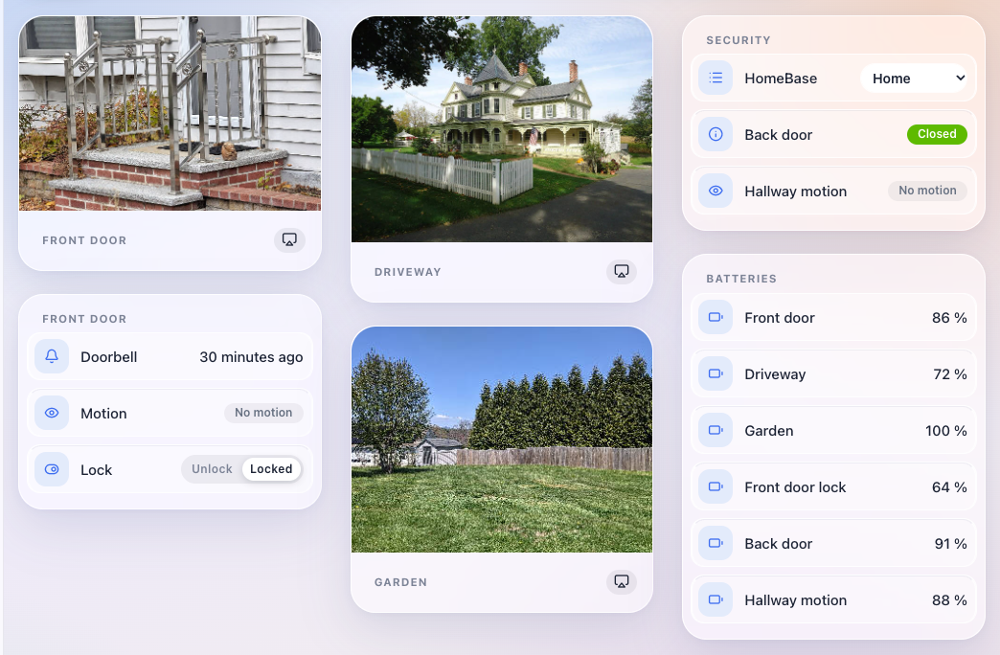
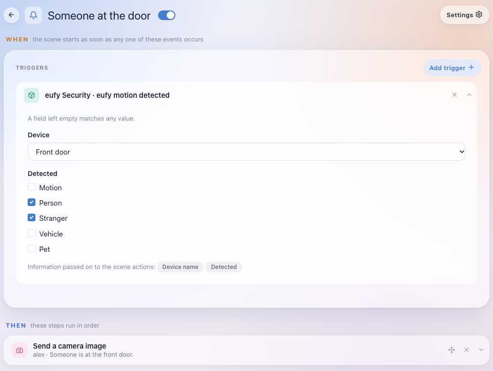

# gladys-eufy

eufy Security external integration for [Gladys Assistant](https://gladysassistant.com): cameras, video doorbells, smart locks, sensors and HomeBase guard mode in Gladys.

Built on the [Gladys external integration platform](https://gladysassistant.com/docs/dev/external-integrations/) and the [`@mega-yfue/eufy-sdk`](https://github.com/mega-yfue/eufy-sdk) library (the successor of `eufy-security-client`). Requires **Gladys 5.1 or later** (scene triggers) and a **dedicated eufy account** the devices are shared with, invitation accepted (eufy keeps one session per account: see the user documentation).

User documentation: [docs/en.md](docs/en.md) · [docs/fr.md](docs/fr.md).

## Screenshots

Cameras with their last thumbnail, the doorbell, the lock, the HomeBase guard mode, sensors and batteries on a dashboard:



A Gladys scene started by the `motion_detected` trigger, filtered on the doorbell and on people, that sends the camera image:



_Captured on a Gladys 5.1 dashboard with simulated devices and states — values are illustrative. Camera images: public domain (CC0) photos from Wikimedia Commons by [Daderot](https://commons.wikimedia.org/wiki/File:Porch_-_Arlington,_MA_-_13.jpg), [Tomwsulcer](https://commons.wikimedia.org/wiki/File:Green_house_with_tree_and_driveway_in_Oldwick_New_Jersey.JPG) and [Chase Bohannon](https://commons.wikimedia.org/wiki/File:Beautiful_Trees_In_A_Backyard.jpg)._

## Supported devices

Devices are mapped by the capabilities eufy-sdk reports, not by model:

| eufy capability                  | Gladys feature                                               |
| -------------------------------- | ------------------------------------------------------------ |
| `camera` / `snapshot`            | `camera` / `image` — push thumbnail after each event         |
| `doorbell`                       | `doorbell` / `ring` — 1 on a press, back to 0 after 5 s      |
| `motion` / `person_detection`    | `motion-sensor` / `binary` — 1 on a detection, 0 after 30 s  |
| `contact`                        | `opening-sensor` / `binary`                                  |
| `lock`                           | `lock` / `binary` — **controllable**, 1 = locked (¹)         |
| `leak` / `smoke` / `co`          | `leak-sensor` / `smoke-sensor` / `co-sensor` — `binary`      |
| `siren`                          | `siren` / `binary` (read-only)                               |
| `arming` (HomeBase, solo camera) | `text` / `select` — **controllable** guard mode (¹)          |
| `battery` (and lock battery)     | `battery` / `integer` + `charging`, `battery-low` / `binary` |

(¹) Unlocking and disarming (guard mode Disarmed or Off) are refused unless `allow_unlock` / `allow_disarm` are switched on in the configuration.

Scene triggers: `doorbell_pressed`, `motion_detected` (`target`: motion / person / stranger / vehicle / pet), `package_delivered`, `alarm_triggered` (`phase`: triggered / delayed).

Not supported: live video (external integrations only carry still images), vacuums, lights and the other eufy appliances.

## Sign-in

The eufy login may ask for a verification code or a captcha. Everything happens in the configuration form: the status banner says what is needed, the user types it in the optional **Verification code** / **Captcha answer** field and saves, and the integration hands it to the pending login, then empties the field. The captcha image is written to the integration logs as a `data:image/png;base64,...` line to paste in a browser — the generated configuration UI cannot show an image.

The session and the push registration are kept in `/data` (`eufy-session.json`, `eufy-push.json`), so a restart does not ask again.

## Project layout

| Path              | Role                                                         |
| ----------------- | ------------------------------------------------------------ |
| `index.js`        | Wiring only: registers the handlers on the SDK               |
| `src/handlers.js` | Orchestration: configuration flow, discovery, image, actions |
| `src/session.js`  | eufy login state machine (code, captcha, retries)            |
| `src/events.js`   | eufy events → states, camera images, scene events            |
| `src/commands.js` | `onSetValue`: lock, guard mode                               |
| `src/mapping.js`  | eufy capabilities → Gladys features                          |
| `src/image.js`    | JPEG → `image/jpg;base64,...` under 150 KB                   |
| `src/eufy.js`     | `EufyMega` factory (stores under `/data`)                    |
| `src/config.js`   | Configuration normalization                                  |
| `src/errors.js`   | eufy error classification (what is retried)                  |
| `src/status.js`   | Connection status messages                                   |

## Development

```sh
npm install
npm run format:check && npm run lint && npm run coverage
```

Run it against a local Gladys (developer mode), with a writable data directory:

```sh
GLADYS_HOST_API_URL=... GLADYS_INTEGRATION_TOKEN=... GLADYS_INTEGRATION_SELECTOR=... \
EUFY_DATA_DIR=./data LOG_LEVEL=debug npm start
```

Validate the manifest offline: `npx github:GladysAssistant/integration-store .`

The CI workflows, `CLAUDE.md` and `SECURITY.md` come from [gladys-integration-kit](https://github.com/cicoub13/gladys-integration-kit): change them there, not here.

## License

Apache-2.0
